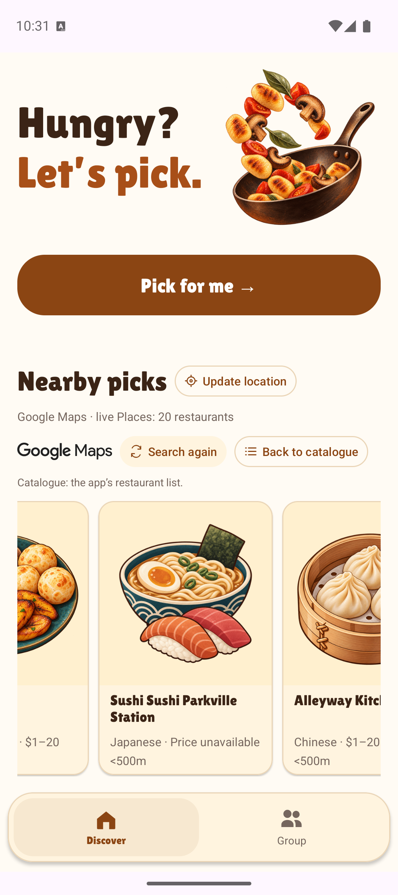
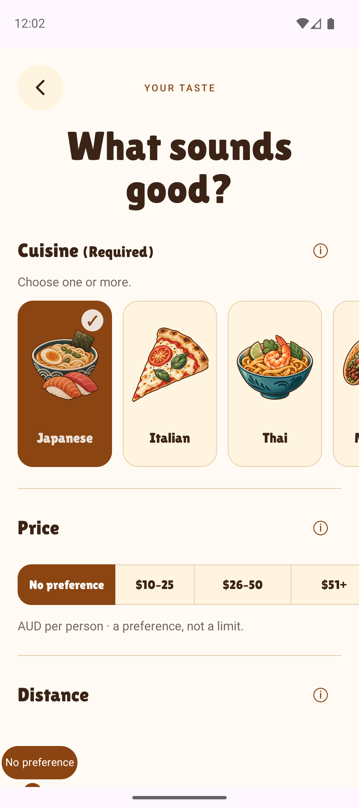
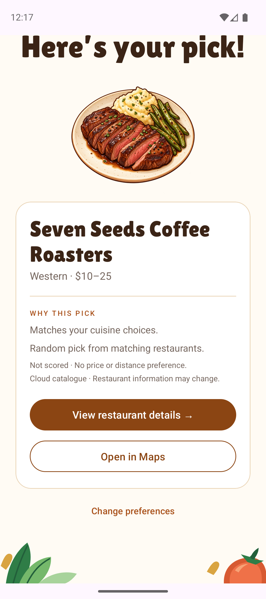

# DineSync

### Helping individuals and groups decide where to eat

DineSync is a native Android restaurant decision app built by a six-person team at the University of Melbourne for COMP90018 Mobile Computing Systems Programming.

I am **Zixin Meng (aerisM)**. My work focused on the Android user experience and its integration with the team's shared data and decision services: restaurant discovery, preferences, results, group rooms, nominations and the shared selection experience.

This repository presents my contribution through screenshots and an engineering case study. It contains documentation and images; it is not a runnable distribution of the team application.

## A look inside

<table>
  <tr>
    <th>Discover</th>
    <th>Set preferences</th>
    <th>Understand the result</th>
  </tr>
  <tr>
    <td></td>
    <td></td>
    <td></td>
  </tr>
</table>

Screenshots are from the team's report materials. They illustrate the integrated application, including shared services and assets. Restaurant information shown is prototype data and may change.

## The product

Choosing somewhere to eat becomes harder when people have different preferences. DineSync supports two journeys:

- **Personal:** browse restaurants, enter cuisine and dietary requirements, optionally specify price and distance preferences, and explore a suggested restaurant.
- **Group:** create or join a room, submit preferences, review shared candidates, nominate a restaurant, and see the group's final selection.

The team application combines shared restaurant data, group matching, Firebase synchronisation and a motion-triggered selection experience. An on-screen action provides an alternative to shaking the phone.

## My contribution

| Area | Work I contributed |
| --- | --- |
| Personal journey | Restaurant discovery, preference entry, result and detail interfaces; navigation and map/detail actions; explanations for missing restaurant information. |
| Group journey | Room entry and lobby screens, readiness feedback, host/member controls, shortlist and nomination interfaces, and shared-result presentation. |
| Service integration | Connected Android screens to the team's room, restaurant, candidate and result interfaces; presented waiting, synchronisation, error and retry states. |
| UI and accessibility | Cream-and-brown visual styling, responsive layouts, minimum 48 dp touch targets, selected-state descriptions, dynamic status announcements and large-text layout fixes. |
| Engineering workflow | Feature branches, pull requests, review feedback, and scoped automated and emulator checks for navigation, input and UI states. |

The project's contribution record lists **26 merged feature/fix pull requests** under my account as of the October 2026 snapshot. This describes collaborative delivery, not sole authorship of every changed line.

The scoring engine, Firebase transactions and security rules, Places/location services, motion sensing and shared restaurant datasets were team contributions. Collaborator-authored recovery fixes and tests retain their original credit.

## Technology

**My main implementation stack:** Kotlin, Android XML, Fragments, View Binding, ViewModel, LiveData and Android Navigation Component.

**Integrated team services:** Firebase Anonymous Authentication, Cloud Firestore, restaurant repositories, recommendation modules and Google Places.

**Validation and collaboration:** JUnit, Espresso, Android emulator checks, Git and pull-request reviews.

## Engineering decisions

### Make asynchronous progress visible

A group participant needs to know whether an action is waiting, complete or unsuccessful. I implemented role-specific screens and state feedback over shared repository interfaces, making input readiness, candidate preparation and member waiting visible.

The integrated application distinguishes local input from acknowledged shared state. Some underlying recovery and pending-command retention logic was supplied by collaborators; my contribution includes presenting and integrating these states.

### Treat the stored result as authoritative

A wheel animation should not create a different answer on every phone. My group-result UI consumes the team's confirmed result and presents the appropriate host/member controls. The transaction that commits the result and the selection algorithm are shared team implementations.

### Explain incomplete information

Restaurant data can omit prices, opening hours or dietary details. I worked on missing-data explanations and optional menu/price presentation so that the interface communicates uncertainty rather than implying that all information is verified.

### Preserve usability with larger text

I added wrapping and expanding layouts, touch-target improvements and accessibility semantics. Focused checks included 200% text and portrait/landscape layouts. These checks do not imply whole-app accessibility certification.

## What I learned

Building a usable Android client involves more than arranging screens. I learned to work with shared contracts, communicate asynchronous state, distinguish presentation from authoritative data, and resolve integration issues through reviews and focused tests.

I used AI coding tools to assist implementation, debugging and review, while remaining responsible for the interaction choices and changes retained in my contributions.

## Project context and attribution

- **Author of this portfolio:** Zixin Meng — [GitHub](https://github.com/aerisM)
- **Team project:** COMP90018, Group T01/05-04, University of Melbourne
- **Original repository:** [DineSync](https://github.com/COMP90018-T01-05-04/DineSync) — access may be restricted.
- **Scope:** an individual portfolio of work within a collaborative university project.

This showcase includes no application source, service credentials or original Git history. Screenshots retain the application's third-party branding and attribution. No licence to redistribute the team application or third-party assets is granted by this portfolio.
